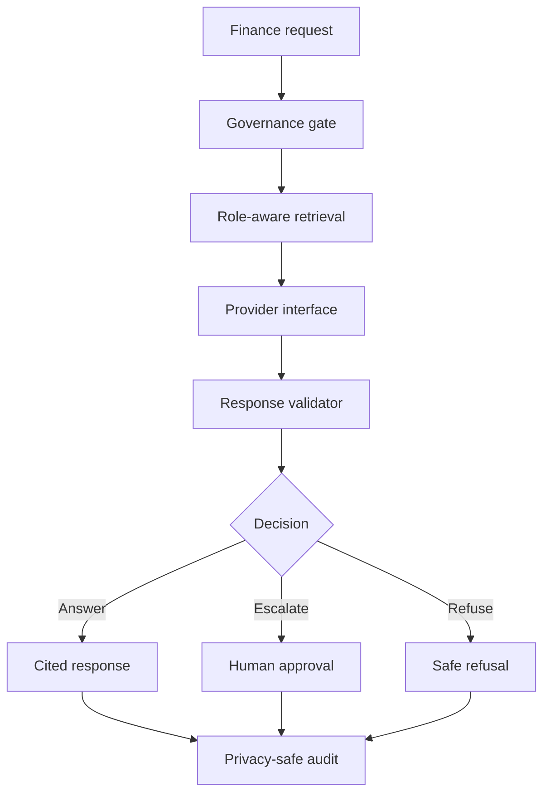

# Governed SAP Finance Assistant

## Business problem

Finance users need quick policy guidance, but a general-purpose assistant can
expose restricted information, invent sources or attempt actions beyond the
user's authority.

## Architecture

## Verified results

- Governance cases: 6/6
- Deployment checks: 11/11
- Portfolio cases: 4/4
- Deployment secret findings: 0

## Platform mapping

| Local component | Databricks implementation | SAP implementation |
|---|---|---|
| Policy chunks | Delta tables and Unity Catalog | Governed SAP business data |
| Role-aware retrieval | Vector Search | Orchestration grounding |
| Provider interface | Model Serving | Generative AI Hub |
| Evaluation report | MLflow evaluation | AI lifecycle governance |
| JSONL traces | MLflow Tracing | BTP monitoring |
| Flask runtime | Databricks App | BTP Cloud Foundry |

## Production limitations

The current provider is deterministic, the data is synthetic and deployment
has only been validated locally. Production requires enterprise identity,
service bindings, live-model evaluation, security testing and monitoring.

## Interview explanation

I built a governed RAG assistant for SAP Finance. It retrieves policy content
authorized for the user's role and company code. Answers cite retrieved
sources, restricted questions are refused and requests to post or approve
transactions require human approval. I also created evaluation gates,
privacy-safe audit traces and an SAP BTP deployment design.
